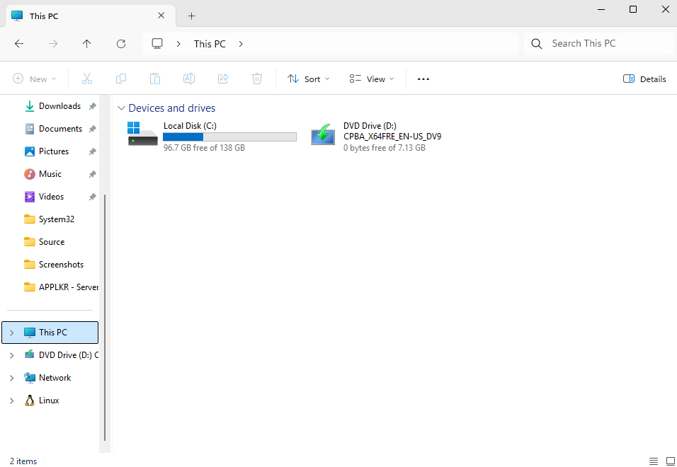
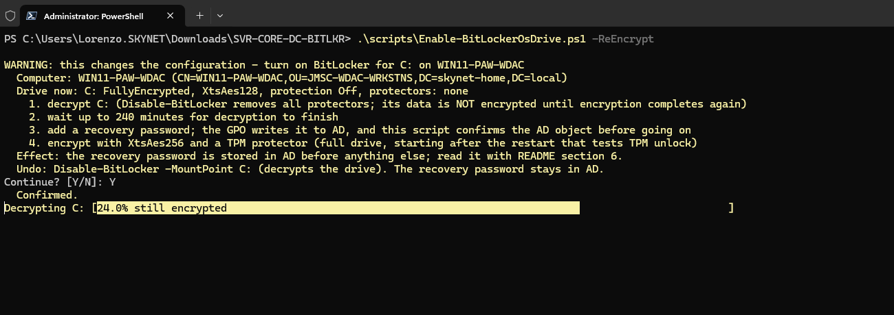
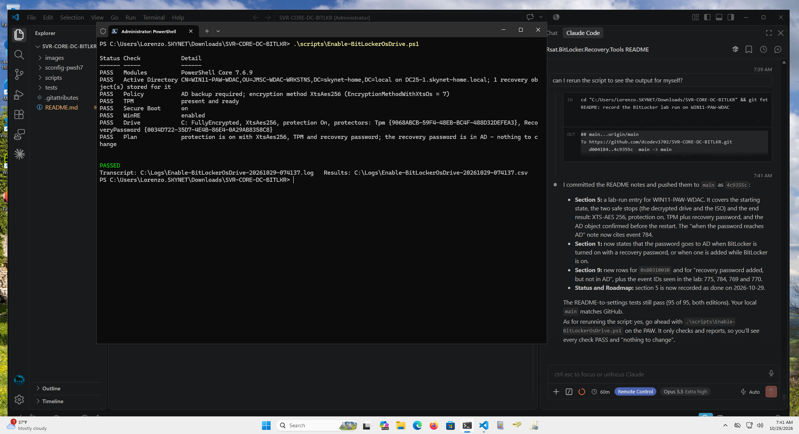

# SVR-CORE-DC-BITLKR — BitLocker recovery keys in Active Directory (Windows Server Core 2025/2022)

> [!NOTE]
> Domain-joined Windows computers can write their **BitLocker recovery passwords and key packages** to **their own computer object in AD DS**. This repository sets that up from a **Server Core 2025 domain controller** with in-box PowerShell only — **no GPMC console, no GUI, no downloads**: one GPO for the clients, a one-time backfill for drives that were encrypted before the GPO existed, and key lookup with `Get-ADObject`. **The domain controller needs no schema extension, no ACL change and no extra role.**

> [!IMPORTANT]
> **Status (2026-10-30): work in progress.** [Section 3](#3-create-the-gpo-server-core-powershell) and [section 5](#5-encrypt-new-drives) have run in the lab with their scripts: two GPOs (workstations and servers) on a Server Core 2025 DC, and BitLocker on a Windows 11 client and on a Windows Server 2025 member server, each with its recovery password in AD. What ran where: [section 10](#10-lab-runbook-what-ran-where) for the workstation, [servers/README.md](servers/README.md) for the server. Sections 4 and 6 and the remaining scripts come next ([Roadmap](#roadmap)). The policy registry value names and values are checked against `VolumeEncryption.admx` / `.adml` as shipped with Windows. Link the GPO to a test OU first.

---

## Contents

1. [How it works](#1-how-it-works)
2. [Prerequisites](#2-prerequisites)
3. [Create the GPO (Server Core, PowerShell)](#3-create-the-gpo-server-core-powershell)
4. [Back up keys of drives that are already encrypted](#4-back-up-keys-of-drives-that-are-already-encrypted)
5. [Encrypt new drives](#5-encrypt-new-drives)
6. [Find a recovery password without a GUI](#6-find-a-recovery-password-without-a-gui)
7. [Who can read the keys](#7-who-can-read-the-keys)
8. [BitLocker on the domain controller itself](#8-bitlocker-on-the-domain-controller-itself)
9. [Troubleshooting](#9-troubleshooting)
10. [Lab runbook: what ran where](#10-lab-runbook-what-ran-where)
- [Roadmap](#roadmap)
- [References](#references)

---

## 1. How it works

1. A GPO enables the *Choose how BitLocker-protected … drives can be recovered* policies on the clients (`HKLM\SOFTWARE\Policies\Microsoft\FVE`).
2. When BitLocker is turned on with a **recovery password** protector, or such a protector is added while BitLocker is on, the client writes it to AD DS with its computer account: a child object of class `msFVE-RecoveryInformation` under its own computer object, named `<timestamp>{<recovery password ID>}` (for example `2026-10-29T07:31:53+01:00{0034D722-…}`).
3. With *Do not enable BitLocker until recovery information is stored to AD DS*, the client will not start encryption if that write fails, so no drive is encrypted without its key in AD.
4. Administrators read the key from AD: `Get-ADObject` on Server Core, or the BitLocker Recovery Password Viewer (RSAT) on a computer with a GUI.

| Attribute on `msFVE-RecoveryInformation` | Content |
|---|---|
| `msFVE-RecoveryPassword` | The 48-digit recovery password. **Confidential attribute** ([section 7](#7-who-can-read-the-keys)). |
| `msFVE-KeyPackage` | Key package (stored with *recovery passwords and key packages*): lets `repair-bde` recover data from a damaged drive. |
| `msFVE-RecoveryGuid` | Recovery password ID — the ID shown on the BitLocker recovery screen. |
| `msFVE-VolumeGuid` | Volume ID. |

**What this does not do**

- It does not encrypt anything. It makes sure that when BitLocker is turned on, the recovery password lands in AD.
- It does not reach back: drives encrypted before the GPO applied keep their keys local until you run the backfill ([section 4](#4-back-up-keys-of-drives-that-are-already-encrypted)).
- It is not Entra ID / Intune escrow (that is `BackupToAAD-BitLockerKeyProtector`).
- *Turn on TPM backup to Active Directory Domain Services* is **not** needed. It is about TPM owner information, not recovery keys, and is deprecated: since Windows 10 1607 Windows no longer keeps the TPM owner password.

---

## 2. Prerequisites

| Item | Detail |
|---|---|
| **Where to run** | A domain controller (every DC has the `ActiveDirectory` and `GroupPolicy` modules; Server Core is fine) or a domain-joined PAW / management computer with RSAT **Group Policy Management** and **Active Directory** tools. Windows PowerShell 5.1, elevated. |
| **Account** | Domain Admin for these steps (create and link a GPO, read the confidential attribute). |
| **Forest** | Schema of Windows Server 2008 or later: `msFVE-RecoveryInformation` has been in the base schema since then, so a Server 2025 forest has it. Check: `Get-ADObject "CN=ms-FVE-RecoveryInformation,$((Get-ADRootDSE).schemaNamingContext)"` |
| **Clients** | Domain-joined Windows 10/11 or Windows Server with a TPM, or a vTPM in a VM (below). Windows Server needs the feature first: `Install-WindowsFeature BitLocker -IncludeAllSubFeature -IncludeManagementTools -Restart`. A DC must be reachable when the recovery password is created. |
| **OU** | The client computers must sit in an **OU**: a GPO cannot be linked to the default `CN=Computers` container. Move them to an OU, or link the GPO at the domain root. |

**A TPM for virtual machines.** The TPM protector needs a TPM in the computer itself, and a VM gets a virtual one from its host. On a **Hyper-V host**, [`scripts/Enable-VmTpm.ps1`](scripts/Enable-VmTpm.ps1) adds it. It takes the VM's name, checks that the VM is Generation 2, shows the plan in yellow and asks Y/N. Then it shuts the VM down if it is running (a normal shutdown through the guest, never a power-off; a Saved or Paused VM is refused), adds a local key protector only if the VM has none (an existing one is kept, so nothing sealed to it is lost), enables the vTPM, starts the VM again and verifies the result. A second run changes nothing.

```powershell
# On the Hyper-V host, elevated; Confirm-Change.ps1 and VmTpmGuidance.ps1 next to the script
.\scripts\Enable-VmTpm.ps1 -VMName 'PDQ - Server 2025' -WhatIf     # plan only
.\scripts\Enable-VmTpm.ps1 -VMName 'PDQ - Server 2025'             # shows the plan, asks Continue? [Y/N]
.\scripts\Enable-VmTpm.ps1 -VMName 'PDQ - Server 2025' -LeaveOff   # do not start the VM again
```

- **The VM's name in Hyper-V**, which can differ from the computer name: in the lab, DC25-1 runs as the VM `DC-1`.
- **Not a Hyper-V host?** Run anywhere else, the script says what that computer is (Hyper-V VM, VMware VM, KVM / Proxmox VM, or physical) and shows how a vTPM is added on each platform, then stops with nothing changed:
  - **VMware vSphere:** VM powered off, EFI firmware, hardware version 14 or later, a key provider in vCenter; then *Edit Settings > Add New Device > Trusted Platform Module*, or in PowerCLI `Get-VM -Name <vm> | New-VTpm`.
  - **Proxmox VE:** VM shut down, OVMF (UEFI) firmware with an EFI disk; then *Hardware > Add > TPM State* (v2.0), or on the Proxmox host `qm set <vmid> -tpmstate0 <storage>:1,version=v2.0`.
- **Pre-flight:** `Enable-BitLockerOsDrive.ps1` checks for the TPM before it changes anything. Without one it names the platform and shows the same steps; in a Hyper-V VM that is the exact `Enable-VmTpm.ps1` command with its VM name and host, read from the guest's Hyper-V integration data.

Tests (mocks, no VM is touched): `.\tests\Test-EnableVmTpm.ps1`, in Windows PowerShell 5.1 and PowerShell 7.

---

## 3. Create the GPO (Server Core, PowerShell)

`Set-GPRegistryValue` writes the same `Registry.pol` entries the GPMC editor would. Because the value names match the ADMX, GPMC on a GUI computer shows them as the normal administrative template settings — provided GPMC finds `VolumeEncryption.admx`. If the domain has a central store (`\\<domain>\SYSVOL\<domain>\Policies\PolicyDefinitions`), GPMC reads templates only from there: copy `VolumeEncryption.admx` and `en-US\VolumeEncryption.adml` into it, or GPMC lists the values under *Extra Registry Settings*. Clients apply them either way.

**Scripted:** [`scripts/Set-BitLockerAdBackupGpo.ps1`](scripts/Set-BitLockerAdBackupGpo.ps1) does what the block below does, from [`scripts/BitLockerAdBackupGpo.json`](scripts/BitLockerAdBackupGpo.json). It also checks every value against `VolumeEncryption.admx`, changes only what differs (a second run changes nothing), backs up an existing GPO first, asks Y/N before any change, verifies the result in AD and SYSVOL, and logs to `C:\Logs`. Windows PowerShell 5.1 or PowerShell 7, on a DC or a domain-joined computer with the GroupPolicy and ActiveDirectory modules:

```powershell
.\scripts\Set-BitLockerAdBackupGpo.ps1 -WhatIf      # plan only
.\scripts\Set-BitLockerAdBackupGpo.ps1              # shows the plan in yellow, asks Continue? [Y/N]
.\scripts\Set-BitLockerAdBackupGpo.ps1 -NoConfirm   # automation
```

**Two GPOs: workstations and servers.** The same script creates a separate GPO for servers from [`scripts/BitLockerAdBackupGpo.Servers.json`](scripts/BitLockerAdBackupGpo.Servers.json): `JMSC_BitLocker_AD_Backup_Servers`, linked to `OU=JMSC-Servers`. It holds the same recovery, AD backup, encryption method and recovery message values, but **not** the deny-write values (`FDVDenyWriteAccess`, `RDVDenyWriteAccess`, `RDVDenyCrossOrg`), so a data disk added to a server later stays writable before it is encrypted. That makes 36 values, all under the SOFTWARE key. A `Backup-GPO` copy of the servers GPO from the lab is in [`servers/gpo/`](servers/gpo/README.md).

```powershell
.\scripts\Set-BitLockerAdBackupGpo.ps1 -SettingsPath .\scripts\BitLockerAdBackupGpo.Servers.json -WhatIf
.\scripts\Set-BitLockerAdBackupGpo.ps1 -SettingsPath .\scripts\BitLockerAdBackupGpo.Servers.json
```

Tests (mocks, nothing in AD is touched): `.\tests\Test-SetBitLockerAdBackupGpo.ps1`, in Windows PowerShell 5.1 and PowerShell 7. They also check that the workstation settings file matches the block below, and that the servers file differs from it only by name, OU and the deny-write values.

**Lab run (2026-10-28, DC25-1):** the script created `JMSC_BitLocker_AD_Backup` with the 24 values and linked it to `OU=JMSC-WDAC-WRKSTNS`. A second run found nothing to change. On WIN11-PAW-WDAC, the computer in that OU, `gpupdate /target:computer` brought all 24 values into `HKLM\SOFTWARE\Policies\Microsoft\FVE`, and `gpresult` lists the GPO as applied. A later run the same day backed up the GPO and added the three encryption-method values (XTS-AES 256, 27 values in all); the PAW received them at its next `gpupdate`. A third update added the hardening values and the recovery-screen message (39 values, 2 of them under the SYSTEM key). Its first attempt stopped after 10 of 12 writes with a brief `E_ACCESSDENIED` from SYSVOL; the script now retries that error, and the next run wrote the last 2, verified all 39 and changed nothing when run again. The PAW shows all of them after `gpupdate`.

**Lab run (2026-10-30, DC25-1):** the script created `JMSC_BitLocker_AD_Backup_Servers` from the servers settings file with 36 values and linked it to `OU=JMSC-Servers`. PDQ-SRVR, the server in that OU, applied it at its next boot ([servers/README.md](servers/README.md#4-the-servers-gpo), steps S5 and S7).


*GPMC after the lab run: `JMSC_BitLocker_AD_Backup` is linked to `JMSC-WDAC-WRKSTNS` as link order 3, link enabled, GPO status Enabled.*

Run the block as one piece (paste all of it, or save it as a `.ps1`). It checks for Active Directory first and stops at the first `STOP` or error; the checks run before anything is created. The domain is read from the computer it runs on, so the same block works in any AD domain.

```powershell
& {
    $ErrorActionPreference = 'Stop'
    Import-Module GroupPolicy, ActiveDirectory

    # Active Directory only: this computer must be domain-joined, and a domain controller must answer
    if (-not (Get-CimInstance -ClassName Win32_ComputerSystem).PartOfDomain) {
        throw 'STOP: this computer is not joined to an Active Directory domain. Run this on a DC or a domain-joined management computer. Nothing was created.'
    }
    try   { $Domain = Get-ADDomain }
    catch { throw "STOP: no domain controller answered for this computer's domain ($($_.Exception.Message)). Check DNS and DC connectivity. Nothing was created." }

    $GpoName  = 'JMSC_BitLocker_AD_Backup'
    $OuName   = 'JMSC-WDAC-WRKSTNS'                 # the client OU, by name
    $Key      = 'HKLM\SOFTWARE\Policies\Microsoft\FVE'
    $DomainDN = $Domain.DistinguishedName           # DC=...,DC=... of the domain this computer is in

    # Find the OU by name anywhere in that domain
    $Ou = @(Get-ADOrganizationalUnit -Filter "Name -eq '$OuName'" -SearchBase $DomainDN)
    if ($Ou.Count -ne 1) { throw "STOP: expected 1 OU named '$OuName' in $DomainDN, found $($Ou.Count). Create it, or change `$OuName. Nothing was created." }
    $Target = $Ou[0].DistinguishedName              # or $DomainDN to link at the domain root
    Write-Host "Domain $($Domain.DNSRoot) ($DomainDN): GPO '$GpoName' will be linked to $Target"

    $gpo = New-GPO -Name $GpoName -Comment 'BitLocker: escrow recovery passwords and key packages to AD DS'

    $values = [ordered]@{
        Recovery                     = 1   # policy Enabled
        ManageDRA                    = 1   # Allow data recovery agent (GPMC default)
        RecoveryPassword             = 2   # 48-digit recovery password: 2 = Allow, 1 = Require, 0 = Do not allow
        RecoveryKey                  = 2   # 256-bit recovery key: same values
        HideRecoveryPage             = 0   # keep the recovery options in the setup wizard
        ActiveDirectoryBackup        = 1   # Save BitLocker recovery information to AD DS
        ActiveDirectoryInfoToStore   = 1   # 1 = recovery passwords and key packages, 2 = recovery passwords only
        RequireActiveDirectoryBackup = 1   # Do not enable BitLocker until recovery information is stored to AD DS
    }
    foreach ($prefix in 'OS', 'FDV', 'RDV') {     # added 'RDV' for removable drives, see below
        foreach ($v in $values.GetEnumerator()) {
            Set-GPRegistryValue -Guid $gpo.Id -Key $Key -ValueName "$prefix$($v.Key)" -Type DWord -Value $v.Value | Out-Null
        }
    }

    # Encryption method for drives encrypted from now on: 7 = XTS-AES 256 (6 = XTS-AES 128, 4 = AES-CBC 256, 3 = AES-CBC 128)
    $methods = [ordered]@{ EncryptionMethodWithXtsOs = 7; EncryptionMethodWithXtsFdv = 7; EncryptionMethodWithXtsRdv = 7 }
    foreach ($m in $methods.GetEnumerator()) {
        Set-GPRegistryValue -Guid $gpo.Id -Key $Key -ValueName $m.Key -Type DWord -Value $m.Value | Out-Null
    }

    # Hardening and the recovery-screen message. The 'Deny write access ...' values live under the SYSTEM key
    # (except RDVDenyCrossOrg, which the ADMX puts under SOFTWARE).
    $sw  = $Key
    $sys = 'HKLM\SYSTEM\CurrentControlSet\Policies\Microsoft\FVE'
    $other = @(
        @($sw,  'OSEncryptionType', 1),               # Enforce drive encryption type: 1 = full encryption (OS drives)
        @($sw,  'FDVEncryptionType', 1),              #   ... fixed data drives
        @($sw,  'RDVEncryptionType', 1),              #   ... removable data drives
        @($sys, 'FDVDenyWriteAccess', 1),             # Deny write access to fixed drives not protected by BitLocker
        @($sys, 'RDVDenyWriteAccess', 1),             # Deny write access to removable drives not protected by BitLocker
        @($sw,  'RDVDenyCrossOrg', 0),                #   ... but allow drives encrypted by other organizations
        @($sw,  'OSHardwareEncryption', 0),           # Hardware-based encryption disabled: BitLocker always uses software
        @($sw,  'FDVHardwareEncryption', 0),
        @($sw,  'RDVHardwareEncryption', 0),
        @($sw,  'DisableExternalDMAUnderLock', 1),    # Disable new DMA devices when this computer is locked
        @($sw,  'RecoveryKeyMessageSource', 2),       # Pre-boot recovery screen: 2 = use custom recovery message
        @($sw,  'RecoveryKeyMessage', 'This drive is locked by BitLocker. Contact your IT administrator and give them the Recovery key ID shown on this screen. The recovery key is stored in Active Directory.')
    )
    foreach ($o in $other) {
        $type = if ($o[2] -is [string]) { 'String' } else { 'DWord' }
        Set-GPRegistryValue -Guid $gpo.Id -Key $o[0] -ValueName $o[1] -Type $type -Value $o[2] | Out-Null
    }

    New-GPLink -Guid $gpo.Id -Target $Target -LinkEnabled Yes

    # Check what the GPO holds: 39 values - 37 under the SOFTWARE key (24 recovery values, 3 encryption methods,
    # 10 hardening and message values), 2 under the SYSTEM key
    Get-GPRegistryValue -Name $GpoName -Key $Key | Sort-Object ValueName | Format-Table ValueName, Value
    Get-GPRegistryValue -Name $GpoName -Key $sys | Sort-Object ValueName | Format-Table ValueName, Value

    # Removable drives: BitLocker To Go only once the key is in AD - expect Value 1
    Get-GPRegistryValue -Name $GpoName -Key $Key -ValueName RDVRequireActiveDirectoryBackup | Format-Table ValueName, Value
}
```

| Registry value (`OS…` / `FDV…` / `RDV…`) | GPMC option |
|---|---|
| `OSRecovery` / `FDVRecovery` / `RDVRecovery` | Policy *Choose how BitLocker-protected operating system / fixed / removable drives can be recovered* = **Enabled** |
| `…ManageDRA` | Allow data recovery agent |
| `…RecoveryPassword` | Configure user storage of BitLocker recovery information: **Allow 48-digit recovery password** |
| `…RecoveryKey` | Configure user storage of BitLocker recovery information: **Allow 256-bit recovery key** |
| `…HideRecoveryPage` | Omit recovery options from the BitLocker setup wizard |
| `…ActiveDirectoryBackup` | Save BitLocker recovery information to AD DS for … drives |
| `…ActiveDirectoryInfoToStore` | Configure storage of BitLocker recovery information to AD DS: **Store recovery passwords and key packages** |
| `…RequireActiveDirectoryBackup` | Do not enable BitLocker until recovery information is stored to AD DS for … drives |
| `EncryptionMethodWithXtsOs` / `…Fdv` / `…Rdv` | Policy *Choose drive encryption method and cipher strength (Windows 10 [Version 1511] and later)* = **Enabled**, **XTS-AES 256-bit** for operating system, fixed and removable drives |
| `OSEncryptionType` / `FDVEncryptionType` / `RDVEncryptionType` = 1 | *Enforce drive encryption type on operating system / fixed data / removable data drives* = **Full encryption** |
| `FDVDenyWriteAccess` = 1 (SYSTEM key) | *Deny write access to fixed drives not protected by BitLocker* = **Enabled** |
| `RDVDenyWriteAccess` = 1 (SYSTEM key), `RDVDenyCrossOrg` = 0 | *Deny write access to removable drives not protected by BitLocker* = **Enabled**, without *Do not allow write access to devices configured in another organization* |
| `OSHardwareEncryption` / `FDVHardwareEncryption` / `RDVHardwareEncryption` = 0 | *Configure use of hardware-based encryption for … drives* = **Disabled**: BitLocker always uses software encryption, not the drive's own |
| `DisableExternalDMAUnderLock` = 1 | *Disable new DMA devices when this computer is locked* = **Enabled** |
| `RecoveryKeyMessageSource` = 2, `RecoveryKeyMessage` | *Configure pre-boot recovery message and URL* = **Use custom recovery message** (the text in the block above) |

> [!NOTE]
> **Hardening values.** Full encryption takes longer than used-space-only, and `Enable-BitLocker -UsedSpaceOnly` is refused. Under the workstation GPO, drives without BitLocker become read-only, USB sticks included, until BitLocker To Go is turned on for them, which in turn needs a reachable DC. The servers GPO leaves these deny-write values out. Put your help desk's name or number into `RecoveryKeyMessage` (in the settings file) and check how it looks on one computer: the pre-boot screen supports only a limited character set. Hardware encryption and DMA protection matter on physical computers; on a Hyper-V VM they change nothing.

> [!NOTE]
> **Encryption method.** The policy applies when BitLocker starts encrypting a drive. A drive that is already encrypted keeps its method (Windows 11 device encryption uses XTS-AES 128) until it is decrypted and encrypted again ([section 5](#5-encrypt-new-drives)). A removable drive encrypted with XTS-AES can be read only on Windows 10 version 1511 or later.

> [!WARNING]
> **Removable drives (`RDV`).** Because `'RDV'` is in the prefix list, the loop also sets `RDVRequireActiveDirectoryBackup = 1` (*Do not enable BitLocker until recovery information is stored to AD DS for removable data drives*). BitLocker To Go can then only be turned on while a DC is reachable.

---

## 4. Back up keys of drives that are already encrypted

The GPO acts when a protector is created; it does not upload keys that already exist. This section is only for drives that **already have a recovery password** from before the GPO applied. A drive with no key protectors at all (*Waiting for Activation*, see [section 5](#5-encrypt-new-drives)) has nothing to back up yet. On each client (elevated), after the GPO has applied:

```powershell
gpupdate /force

foreach ($vol in Get-BitLockerVolume | Where-Object VolumeStatus -ne 'FullyDecrypted') {
    $vol.KeyProtector | Where-Object KeyProtectorType -eq 'RecoveryPassword' | ForEach-Object {
        Backup-BitLockerKeyProtector -MountPoint $vol.MountPoint -KeyProtectorId $_.KeyProtectorId
    }
}
```

- **A drive with no recovery password** (TPM only): `Add-BitLockerKeyProtector -MountPoint C: -RecoveryPasswordProtector`. Under the GPO the new password is written to AD as it is created.
- **`manage-bde` equivalent:** `manage-bde -protectors -get C:` for the ID, then `manage-bde -protectors -adbackup C: -id {<ID>}`.
- **Many computers:** run the same block with `Invoke-Command -ComputerName <list>`.

---

## 5. Encrypt new drives

Once the GPO applies, the recovery password is escrowed however BitLocker is turned on (Control Panel, `manage-bde`, PowerShell). A TPM-only drive has **no** recovery password, so there would be nothing to escrow — add the recovery password protector first:

```powershell
Add-BitLockerKeyProtector -MountPoint C: -RecoveryPasswordProtector   # on a decrypted drive: created, not yet in AD
Enable-BitLocker -MountPoint C: -EncryptionMethod XtsAes256 -TpmProtector   # full drive, XTS-AES 256: both as the GPO requires
```

> [!NOTE]
> **When the password reaches AD.** On a drive where BitLocker is already on (encrypted, including *Waiting for Activation*), a new recovery password is written to AD as it is created. On a **decrypted** drive it is not: BitLocker cannot back up yet (`Backup-BitLockerKeyProtector` fails with `FVE_E_NOT_ACTIVATED`), and writes the password to AD when encryption is turned on. With `RequireActiveDirectoryBackup = 1` it does not encrypt unless that write succeeds. Seen on WIN11-PAW-WDAC: on the decrypted drive the protector was created (event 775) and no AD object appeared; `Enable-BitLocker` then wrote it to AD (event 784, *recovery information was backed up successfully to Active Directory Domain Services*) **before the restart**, and only after that scheduled encryption (event 769).

> [!IMPORTANT]
> **"Waiting for Activation" (Windows 11 device encryption).** A new Windows 11 computer is often already encrypted with XTS-AES 128 but holds only a *clear key*: `Get-BitLockerVolume C:` shows `FullyEncrypted`, protection `Off` and no key protectors. The data is encrypted but not protected, and there is no recovery password yet, so [section 4](#4-back-up-keys-of-drives-that-are-already-encrypted) has nothing to back up. To protect it, add the recovery password (stored in AD), then a TPM protector, then turn protection on. To get XTS-AES 256 instead, the drive has to be decrypted and encrypted again.

**Scripted:** [`scripts/Enable-BitLockerOsDrive.ps1`](scripts/Enable-BitLockerOsDrive.ps1) handles all of these cases for the operating system drive: decrypted, *Waiting for Activation*, suspended, and (with `-ReEncrypt`) a drive encrypted with another method. On a drive where BitLocker is already on, it adds or backs up the recovery password and **confirms the AD object for that exact protector before any other step**. On a decrypted drive it adds the recovery password, encrypts with the GPO's method (XTS-AES 256) and the TPM, and then confirms the AD object; BitLocker itself refuses to encrypt without it. It never prints or logs the recovery password. Order on a client, elevated:

1. Make sure the GPO has applied: `gpupdate /target:computer`, then `gpresult /scope computer /r` lists `JMSC_BitLocker_AD_Backup` (on a server, `JMSC_BitLocker_AD_Backup_Servers`). A Windows Server also needs the BitLocker feature and a TPM first ([section 2](#2-prerequisites)).
2. See the plan, then run it (`-ReEncrypt` only if the drive uses another method, such as XTS-AES 128):

   ```powershell
   .\scripts\Enable-BitLockerOsDrive.ps1 -ReEncrypt -WhatIf    # plan only
   .\scripts\Enable-BitLockerOsDrive.ps1 -ReEncrypt            # shows the plan in yellow, asks Continue? [Y/N]
   ```

3. Restart. The hardware test checks that the TPM unlocks the drive, then encryption starts (`-SkipHardwareTest` starts it at once).
4. Run the script again: it verifies method, protectors and the recovery password in AD, and changes nothing if all is in place. If BitLocker only writes the password to AD when encryption starts, this is the run that confirms it. Read the password from AD with [section 6](#6-find-a-recovery-password-without-a-gui).

Run it on the computer itself: at its console, or as SYSTEM through a scheduled task or a deployment tool. In a plain WinRM session its AD lookups fail (the second hop), and a SYSTEM run cannot see the recovery objects in AD, so it reports the password as "not in AD yet" even after event 784. Verify from an admin account instead ([servers/README.md, section 7](servers/README.md#7-what-the-server-run-showed)).

Tests (mocks, nothing on the computer or in AD is touched): `.\tests\Test-EnableBitLockerOsDrive.ps1`, in Windows PowerShell 5.1 and PowerShell 7.

**Lab run (2026-10-29, WIN11-PAW-WDAC, a Hyper-V VM with a virtual TPM).** C: started *Waiting for Activation* with XTS-AES 128. The screenshots follow the run in order. The script stopped safely twice on the way, and both cases are now built in.

**Before BitLocker**



*1. The starting point: C:, and in D: the Windows installation ISO that later blocked `Enable-BitLocker`.*


*2. The first run with `-ReEncrypt`: the plan in yellow, confirmed with Y. This was the script's first version. Its step 3 expected the AD object before encrypting, which a decrypted drive cannot give (see the note above), so after decrypting the run stopped there. The script now turns BitLocker on first and then confirms the AD object.*



*3. Decryption in progress. It took about two minutes: decryption started at 07:14:17 (event 770), and the recovery password was created at 07:16:19 (event 775).*

The next run was refused with `0x80310030`: the ISO from picture 1 was still in the VM's DVD drive. The script now checks for a disc or ISO before the first change.

**BitLocker enabled**


*4. With the ISO removed: the script added the recovery password, turned BitLocker on with XTS-AES 256 and the TPM, and confirmed the AD object `2026-10-29T07:31:53+01:00{0034D722-…}` (event 784), all before the restart. The hardware test was then pending.*


*5. After the restart the hardware test passed and encryption started (notification at 7:34).*



*6. Running the script again: `FullyEncrypted`, XTS-AES 256, protection **On**, protectors TPM and recovery password, one recovery object in AD - nothing to change. The output shows protector IDs only, never the recovery password.*


*7. The same result in Control Panel (System and Security > BitLocker Drive Encryption): **C: BitLocker on**. The yellow banner, "some settings are managed by your system administrator", appears because the `JMSC_BitLocker_AD_Backup` GPO sets BitLocker policy on this computer.*


*8. The copy in AD, as an administrator sees it: ADUC with the BitLocker Recovery Password Viewer ([section 6](#6-find-a-recovery-password-without-a-gui)), **WIN11-PAW-WDAC** > **Properties** > **BitLocker Recovery**. The Password ID matches the protector the script added in picture 4, and the date, 07:31:53, matches the AD object. The recovery password is redacted in this screenshot.*


*9. Both ways to look the key up, side by side. Left: the computer's **BitLocker Recovery** tab, as in picture 8. Right: right-click the domain, **skynet-home.local** > **Find BitLocker recovery password**, and enter the first 8 characters of the Password ID, `0034D722`. The search returns the same single entry (domain SKYNET-HOME, computer WIN11-PAW-WDAC). This is the help desk path when a computer is stuck at the recovery screen. The user reads out the Recovery key ID, as the GPO's custom recovery message asks. The admin searches for its first 8 characters and checks that the full ID matches before reading out the password. Both recovery passwords are redacted in this screenshot.*

---

## 6. Find a recovery password without a GUI

On the DC or the PAW:

```powershell
# All keys stored for one computer, newest last
$pc = Get-ADComputer 'WIN11-PAW-WDAC'
Get-ADObject -SearchBase $pc.DistinguishedName -Filter "objectClass -eq 'msFVE-RecoveryInformation'" `
    -Properties msFVE-RecoveryPassword, whenCreated |
    Sort-Object whenCreated | Select-Object whenCreated, msFVE-RecoveryPassword

# By the first 8 characters of the recovery key ID shown on the recovery screen
Get-ADObject -Filter "objectClass -eq 'msFVE-RecoveryInformation' -and Name -like '*{6F1C2D3E*'" `
    -Properties msFVE-RecoveryPassword | Select-Object DistinguishedName, msFVE-RecoveryPassword
```

**With a GUI:** on a domain-joined Windows 11 computer, install the BitLocker Recovery Password Viewer from an elevated prompt:

```powershell
DISM.exe /Online /Add-Capability /CapabilityName:Rsat.BitLocker.Recovery.Tools~~~~0.0.1.0

# Verify: State : Installed
DISM.exe /Online /Get-CapabilityInfo /CapabilityName:Rsat.BitLocker.Recovery.Tools~~~~0.0.1.0
```

The viewer is an ADUC extension. If ADUC isn't installed yet, add it the same way first: `DISM.exe /Online /Add-Capability /CapabilityName:Rsat.ActiveDirectory.DS-LDS.Tools~~~~0.0.1.0`.

Reopen ADUC; it then shows a **BitLocker Recovery** tab on computer objects and *Find BitLocker recovery password* on the domain. Without Internet access, append `/Source:<Features on Demand media> /LimitAccess`.

- **One computer:** right-click the computer object (here in **JMSC-WDAC-WRKSTNS**) > **Properties** > **BitLocker Recovery**. Picture 8 in [section 5](#5-encrypt-new-drives) shows the tab.
- **By the ID on the recovery screen:** right-click the domain > **Find BitLocker recovery password**, enter the first 8 characters of the Password ID, then check that the full ID matches. Picture 9 shows both views side by side.
- An empty tab can mean either no keys or no read rights: by default only Domain Admins can read recovery passwords ([section 7](#7-who-can-read-the-keys)). Run ADUC with an account that has those rights.

> [!NOTE]
> The DISM module cmdlets (`Add-WindowsCapability`, `Get-WindowsCapability`) fail in PowerShell 7 with `Class not registered`. Use `DISM.exe`, which works from any shell, or run the cmdlets from Windows PowerShell 5.1 (`powershell.exe`).

---

## 7. Who can read the keys

- `msFVE-RecoveryPassword` is a **confidential attribute**. By default only Domain Admins can read it; an account without the right sees the object with an empty password.
- **Help desk:** delegate on the client OU — Delegation of Control Wizard → custom task → *msFVE-RecoveryInformation objects* → Full Control. The wizard needs a GUI computer; a PowerShell version for Server Core is on the [Roadmap](#roadmap).

---

## 8. BitLocker on the domain controller itself

Only needed if you also want to encrypt the DC's own drives.

1. **Feature** (Server Core 2025): `Install-WindowsFeature BitLocker -IncludeAllSubFeature -IncludeManagementTools -Restart`
2. **TPM.** A Hyper-V Generation 2 VM needs a vTPM. On the host: `.\scripts\Enable-VmTpm.ps1 -VMName <vm>` ([section 2](#2-prerequisites)). By hand, with the VM shut down: `Set-VMKeyProtector -VMName <vm> -NewLocalKeyProtector; Enable-VMTPM -VMName <vm>`
3. **Escrow.** If the GPO also applies to the DC (link to the *Domain Controllers* OU or the domain root), the DC writes its own key into AD.

> [!CAUTION]
> **A DC is a poor sole keeper of its own key.** If the DC boots into BitLocker recovery, the copy in its own database is out of reach. With more than one DC, another DC holds a replica. With a **single DC** (typical in a lab), keep a copy outside the VM — e.g. the output of `(Get-BitLockerVolume C:).KeyProtector | Where-Object KeyProtectorType -eq 'RecoveryPassword'` in your password vault.

---

## 9. Troubleshooting

| Symptom | Check |
|---|---|
| No `msFVE-RecoveryInformation` object appears | On the client: `gpresult /scope computer /r` lists the GPO; `Get-ItemProperty HKLM:\SOFTWARE\Policies\Microsoft\FVE` shows the values; the volume has a `RecoveryPassword` protector; for drives encrypted earlier, the backfill ([section 4](#4-back-up-keys-of-drives-that-are-already-encrypted)) ran. |
| `Add-BitLockerKeyProtector` / `Enable-BitLocker` fails with an AD backup error | No DC reachable — `RequireActiveDirectoryBackup` is doing its job. Fix name resolution / connectivity and retry. |
| `New-GPLink` fails on `CN=Computers` | Containers cannot take GPO links. Use an OU, or the domain root. |
| `Enable-BitLockerOsDrive.ps1`: *STOP: no TPM was found* | The computer has no TPM. The message names the platform and the fix; above the results table are the steps. On a Hyper-V VM: `.\scripts\Enable-VmTpm.ps1 -VMName <vm>` on its host ([section 2](#2-prerequisites)). |
| `Enable-BitLocker` fails with `0x80310030` (*bootable media (CD or DVD)*) | A disc or ISO is in an optical drive. Remove it (Hyper-V host: `Get-VMDvdDrive -VMName <vm> \| Set-VMDvdDrive -Path $null`), restart, run again. |
| Recovery password added, but no AD object | Normal on a decrypted drive: BitLocker writes it to AD when it is turned on (event 784). `Backup-BitLockerKeyProtector` cannot help there (`FVE_E_NOT_ACTIVATED`). |
| `Get-ADObject` returns the object but no password | The account cannot read the confidential attribute ([section 7](#7-who-can-read-the-keys)). |
| `Enable-BitLockerOsDrive.ps1` over WinRM: *An operations error occurred* at the AD check | The second hop: a remote session cannot query LDAP on the DC. Run the script at the computer's console or as SYSTEM ([servers/README.md, section 7](servers/README.md#7-what-the-server-run-showed)). |
| Run as SYSTEM: WARN *recovery password … is not in AD yet*, but event 784 is logged | The computer account writes its recovery object but cannot read it. Event 784's fourth data field is the protector ID; confirm the AD object from an admin account ([section 6](#6-find-a-recovery-password-without-a-gui)). |
| What did BitLocker do? | `Get-WinEvent -LogName 'Microsoft-Windows-BitLocker/BitLocker Management' -MaxEvents 20` (Event Viewer: *Applications and Services Logs → Microsoft → Windows → BitLocker-API → Management*). Seen in the lab: 775 key protector created, 784 recovery information backed up to AD DS, 769 encryption will start at the next restart, 770 decryption started. |

---

## 10. Lab runbook: what ran where

Everything that ran in the lab to get the workstation's BitLocker recovery password into AD, in order, with the machine each step ran on. The PAW was the management computer throughout: scripts that change a machine were copied from the PAW to that machine and ran there. **The server, PDQ-SRVR, has its own write-up: [servers/README.md](servers/README.md).**

### Machines

| Machine | Role | Shell |
|---|---|---|
| **WIN11-PAW-WDAC** | Windows 11 Enterprise PAW, Hyper-V VM with a vTPM, in `OU=JMSC-WDAC-WRKSTNS`. Management computer for every step, and the first BitLocker client. | PowerShell 7.6.9, elevated |
| **DC25-1** | Server Core 2025 domain controller of `skynet-home.local`. Creates and links the GPOs. | PowerShell 7.6.9 or Windows PowerShell 5.1, over WinRM from the PAW |
| **PDQ-SRVR** | Windows Server 2025 Datacenter member server in `OU=JMSC-Servers`: see [servers/README.md](servers/README.md). | PowerShell 7.6.9 over WinRM from the PAW (`PowerShell.7` endpoint) |
| **RYZEN-BEE** | Hyper-V host of both VMs. Not domain-joined and not reachable over WinRM from the PAW. | Windows PowerShell, elevated, on the host |

### Modules and features

| Where | What | Installed with | Used for |
|---|---|---|---|
| PAW | `Rsat.ActiveDirectory.DS-LDS.Tools` | `DISM.exe /Online /Add-Capability` ([section 6](#6-find-a-recovery-password-without-a-gui)) | `ActiveDirectory` module, ADUC |
| PAW | `Rsat.GroupPolicy.Management.Tools` | the same | `GroupPolicy` module (in PowerShell 7: `Import-Module GroupPolicy -SkipEditionCheck`) |
| PAW | `Rsat.BitLocker.Recovery.Tools` | the same | BitLocker Recovery tab in ADUC (pictures 8 and 9) |
| PAW | `BitLocker`, `TrustedPlatformModule`, `SecureBoot` modules | in-box on Windows 11 | `Enable-BitLockerOsDrive.ps1` |
| DC25-1 | `ActiveDirectory`, `GroupPolicy` modules | in-box with the AD DS role | `Set-BitLockerAdBackupGpo.ps1`. Under PowerShell 7 it loads `GroupPolicy` natively and `ActiveDirectory` through Windows PowerShell compatibility. |
| DC25-1 | PowerShell 7.6.9 | MSI, installed earlier | the `PowerShell.7` remoting endpoint |

What a server needs on top of this (PowerShell 7, the BitLocker feature, a vTPM) is in [servers/README.md](servers/README.md#3-what-the-server-needs).

### Workstation: WIN11-PAW-WDAC (2026-10-28 and 2026-10-29)

| # | Ran on | How | Step | Result |
|---|---|---|---|---|
| W1 | PAW | elevated | the three RSAT capabilities with `DISM.exe` | AD, Group Policy and BitLocker viewer tools |
| W2 | DC25-1 | scripts copied from the PAW over WinRM, run there | `Set-BitLockerAdBackupGpo.ps1 -WhatIf`, then `-NoConfirm` | `JMSC_BitLocker_AD_Backup` linked to `OU=JMSC-WDAC-WRKSTNS`, later updated to 39 values ([section 3](#3-create-the-gpo-server-core-powershell)) |
| W3 | PAW | elevated | `gpupdate /target:computer`, `gpresult /scope computer /r` | GPO applied |
| W4 | PAW | elevated PowerShell 7, by hand | `Enable-BitLockerOsDrive.ps1 -ReEncrypt` | decrypted the XTS-AES 128 drive (pictures 2 and 3) |
| W5 | RYZEN-BEE | Hyper-V | removed the Windows ISO from the VM's DVD drive | after `Enable-BitLocker` refused with `0x80310030` |
| W6 | PAW | elevated PowerShell 7, by hand | `Enable-BitLockerOsDrive.ps1` | recovery password `{0034D722-…}`, BitLocker on with XTS-AES 256 and the TPM, AD object (event 784) before the restart (picture 4) |
| W7 | PAW | | restart | hardware test passed, encryption started (picture 5) |
| W8 | PAW | elevated PowerShell 7, by hand | `Enable-BitLockerOsDrive.ps1` again | nothing to change (pictures 6 and 7) |
| W9 | PAW | ADUC | BitLocker Recovery tab; *Find BitLocker recovery password* | pictures 8 and 9 |

### Server: PDQ-SRVR (2026-10-30)

Its own write-up, with screenshots: **[servers/README.md](servers/README.md)**. It covers what the server needed (PowerShell 7, the BitLocker feature, a vTPM), the separate servers GPO, every step in order with where it ran (steps S1 to S12), the result in AD, and what the run showed, for example why the BitLocker script ran as SYSTEM and why it then cannot see its own recovery object.

---

## Roadmap

- [ ] Run sections 3–6 in the lab against a Server Core 2025 DC and record the results here (section 3: done 2026-10-28, servers GPO 2026-10-30; section 5: done 2026-10-29 on a workstation, 2026-10-30 on a server).
- [ ] `Enable-BitLockerOsDrive.ps1`: when run as SYSTEM, accept event 784 for the new protector as proof of the AD backup, since the computer account cannot read its recovery objects.
- [x] Script the GPO creation (settings file, `-WhatIf`): [`scripts/Set-BitLockerAdBackupGpo.ps1`](scripts/Set-BitLockerAdBackupGpo.ps1).
- [x] Script the vTPM for Hyper-V VMs, with steps for VMware vSphere and Proxmox VE: [`scripts/Enable-VmTpm.ps1`](scripts/Enable-VmTpm.ps1).
- [ ] Script the backfill for a list of computers.
- [ ] Script key lookup by computer name or recovery key ID.
- [ ] Help-desk delegation from PowerShell (no Delegation of Control Wizard on Server Core).
- [ ] Report: computers with BitLocker on but no recovery password in AD.

---

## References

- Microsoft Learn — [BitLocker recovery overview](https://learn.microsoft.com/windows/security/operating-system-security/data-protection/bitlocker/recovery-overview)
- Microsoft Learn — [BitLocker recovery process](https://learn.microsoft.com/windows/security/operating-system-security/data-protection/bitlocker/recovery-process)
- Microsoft Learn — [Configure BitLocker (policy settings)](https://learn.microsoft.com/windows/security/operating-system-security/data-protection/bitlocker/configure)
- Microsoft Learn — [`Backup-BitLockerKeyProtector`](https://learn.microsoft.com/powershell/module/bitlocker/backup-bitlockerkeyprotector)
- Microsoft Learn — [`Set-GPRegistryValue`](https://learn.microsoft.com/powershell/module/grouppolicy/set-gpregistryvalue)
- Companion repository — [SVR-CORE-DC-APPLKR](https://github.com/dcodev1702/SVR-CORE-DC-APPLKR): AppLocker on Server Core 2025 domain controllers.
