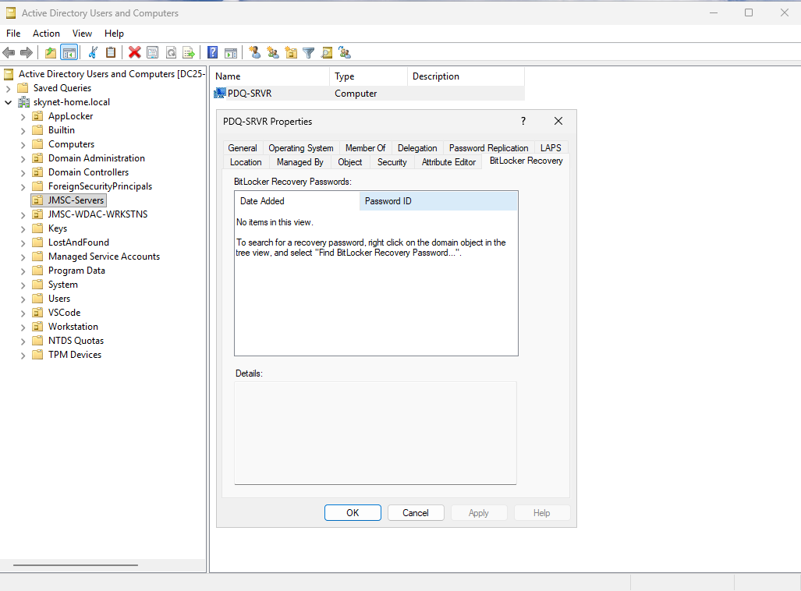
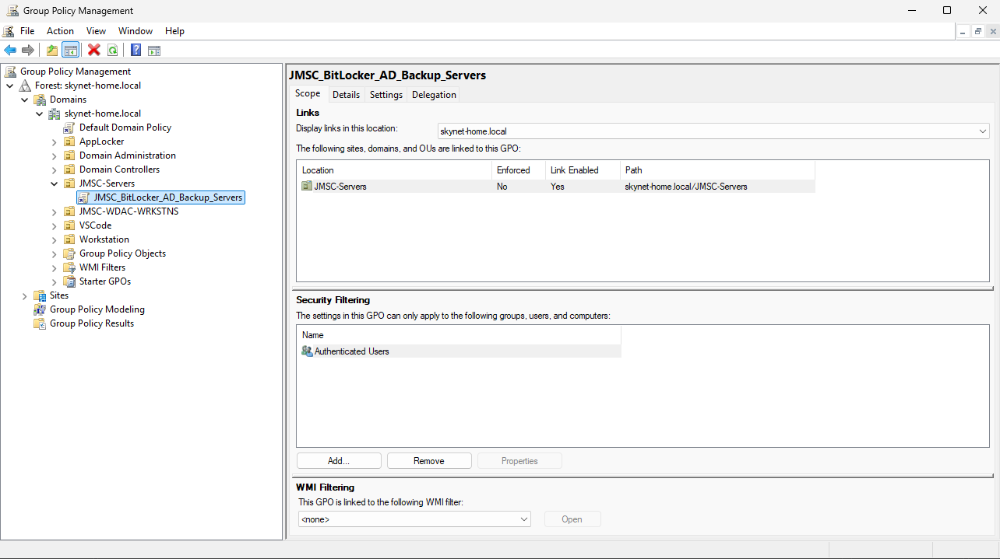
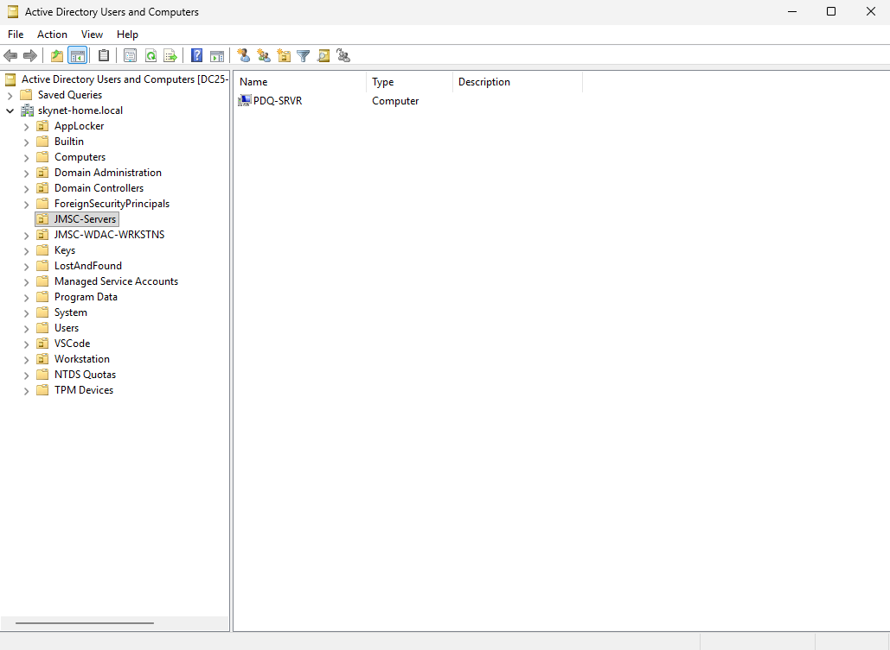

# BitLocker recovery keys in AD on a member server (PDQ-SRVR)

> [!NOTE]
> How the lab's member server **PDQ-SRVR** (Windows Server 2025 Datacenter, in its own OU `JMSC-Servers`) got BitLocker on its operating system drive, with the recovery password stored in AD DS before encryption started. It uses the same two scripts as the workstation in the [README](../README.md), with a **separate GPO for servers**. Every step below says which machine it ran on and how. Lab run: 2026-10-30, all of it driven from the PAW.

**Result.** C: is `FullyEncrypted` with XTS-AES 256, protection On, with a TPM protector and recovery password `{3D7D76AD-7658-4C77-BB2E-B235B48061B6}`. AD holds exactly one recovery object for PDQ-SRVR: `2026-10-29T23:44:34-08:00{3D7D76AD-…}`.

**FILE-SRVR-1**, a second member server (Hyper-V VM on the host GTR-PRO), went through the same steps on 2026-10-30 and was joined straight into `JMSC-Servers`: [run log](FILE-SRVR-1/FILE-SRVR-1-domain-bitlocker-log.md), [logs](server-logs/FILE-SRVR-1/), [screenshots](FILE-SRVR-1/FILE-SRVR-1-domain-bitlocker-log.md#screenshots).

---

## Contents

1. [Machines](#1-machines)
2. [Starting point](#2-starting-point)
3. [What the server needs](#3-what-the-server-needs)
4. [The servers GPO](#4-the-servers-gpo)
5. [What ran where, in order](#5-what-ran-where-in-order)
6. [Result](#6-result)
7. [What the server run showed](#7-what-the-server-run-showed)
8. [Logs](#8-logs)
9. [Check BitLocker on the server](#9-check-bitlocker-on-the-server)

---

## 1. Machines

| Machine | Role | Shell |
|---|---|---|
| **WIN11-PAW-WDAC** | Windows 11 PAW, the management computer. Every step was started here. | PowerShell 7.6.9, elevated |
| **DC25-1** | Server Core 2025 domain controller of `skynet-home.local`. Creates and links the GPO. | PowerShell 7.6.9 over WinRM from the PAW (`PowerShell.7` endpoint) |
| **PDQ-SRVR** | Windows Server 2025 Datacenter (Desktop Experience), Hyper-V Generation 2 VM named `PDQ - Server 2025`, in `OU=JMSC-Servers`. The server being encrypted. | PowerShell 7.6.9 over WinRM from the PAW (`PowerShell.7` endpoint), and SYSTEM for the BitLocker script |
| **RYZEN-BEE** | Hyper-V host of PDQ-SRVR. Not domain-joined and not reachable over WinRM from the PAW. | Windows PowerShell, elevated, on the host |

Times below are PDQ-SRVR's and DC25-1's clocks, which read 2026-10-29, UTC-08:00 (as in the AD object name).

---

## 2. Starting point

A read-only check from the PAW (step S1) found a fresh Hyper-V VM with only C: (89 GB), Secure Boot on, **no TPM**, no BitLocker feature or module, and no BitLocker policy. In AD, PDQ-SRVR had no recovery passwords:



*1. Before: PDQ-SRVR in `JMSC-Servers`, BitLocker Recovery tab in ADUC: "No items in this view".*

---

## 3. What the server needs

| Where | What | Installed with | Used for |
|---|---|---|---|
| PDQ-SRVR | PowerShell 7.6.9 | MSI copied from the PAW (step S2) | the `PowerShell.7` remoting endpoint, used for every later step |
| PDQ-SRVR | `BitLocker` feature and module | `Install-WindowsFeature BitLocker -IncludeAllSubFeature -IncludeManagementTools` (step S3). 11 features: BitLocker, Enhanced Storage, the BitLocker admin tools, the Recovery Password Viewer and the AD DS snap-ins it needs | `Enable-BitLockerOsDrive.ps1` |
| PDQ-SRVR | `TrustedPlatformModule`, `SecureBoot` modules | in-box on Windows Server 2025 | the script's TPM and Secure Boot checks |
| PDQ-SRVR | vTPM | Hyper-V on RYZEN-BEE (step S6); now [`scripts/Enable-VmTpm.ps1`](../scripts/Enable-VmTpm.ps1) | the TPM protector |
| RYZEN-BEE | `Hyper-V` module | in-box with Hyper-V | `Set-VMKeyProtector`, `Enable-VMTPM`, or `Enable-VmTpm.ps1`, which runs them |
| DC25-1 | `ActiveDirectory`, `GroupPolicy` modules; PowerShell 7.6.9 | in-box with the AD DS role; MSI, installed earlier | `Set-BitLockerAdBackupGpo.ps1`. Under PowerShell 7 it loads `GroupPolicy` natively and `ActiveDirectory` through Windows PowerShell compatibility. |
| PAW | RSAT AD DS, Group Policy and BitLocker Recovery Password Viewer tools | `DISM.exe /Online /Add-Capability` ([README section 6](../README.md#6-find-a-recovery-password-without-a-gui)) | `Get-ADObject`, GPMC, ADUC |

Windows Server does not have BitLocker until the feature is installed, and a VM has no TPM until the host adds one. Without either, `Enable-BitLockerOsDrive.ps1` stops at its module or TPM check. Without a TPM it also names the platform and shows how to add one; for PDQ-SRVR that is `.\scripts\Enable-VmTpm.ps1 -VMName 'PDQ - Server 2025'` on RYZEN-BEE ([README section 2](../README.md#2-prerequisites)). One shutdown covers both: install the feature without restarting, then let `Enable-VmTpm.ps1` shut the VM down, add the vTPM and start it again.

---

## 4. The servers GPO

Servers get their own GPO, `JMSC_BitLocker_AD_Backup_Servers`, linked to `OU=JMSC-Servers`. Workstations keep `JMSC_BitLocker_AD_Backup` on `OU=JMSC-WDAC-WRKSTNS`. The servers GPO comes from [`scripts/BitLockerAdBackupGpo.Servers.json`](../scripts/BitLockerAdBackupGpo.Servers.json) and has the same recovery, AD backup, encryption method (XTS-AES 256), full-encryption and recovery-message values as the workstation GPO, but **not** the deny-write values:

| Left out | Workstation GPO | Why not on servers |
|---|---|---|
| `FDVDenyWriteAccess` = 1 | fixed data drives without BitLocker are read-only | a data disk added to the server later (such as a PDQ repository) would be read-only until encrypted |
| `RDVDenyWriteAccess` = 1, `RDVDenyCrossOrg` = 0 | removable drives without BitLocker are read-only | not wanted on servers |

That leaves 36 values, all under `HKLM\SOFTWARE\Policies\Microsoft\FVE`. The script is the same as for workstations; only the settings file differs:

```powershell
.\scripts\Set-BitLockerAdBackupGpo.ps1 -SettingsPath .\scripts\BitLockerAdBackupGpo.Servers.json -WhatIf
.\scripts\Set-BitLockerAdBackupGpo.ps1 -SettingsPath .\scripts\BitLockerAdBackupGpo.Servers.json
```

A `Backup-GPO` copy of the GPO as created in the lab, with a readable HTML report of its settings, is in [`gpo/JMSC_BitLocker_AD_Backup_Servers/`](gpo/JMSC_BitLocker_AD_Backup_Servers/) ([how to use it](gpo/README.md)).

The tests (`.\tests\Test-SetBitLockerAdBackupGpo.ps1`) check that the servers file differs from the workstation file only by name, OU and the deny-write values, and run it end to end against mocks: 36 values, nothing under the SYSTEM key, linked to `JMSC-Servers`, and a second run changes nothing.



*2. GPMC after step S5: `JMSC_BitLocker_AD_Backup_Servers` is linked to `JMSC-Servers`, link enabled, not enforced, filtered to Authenticated Users. The workstation OU `JMSC-WDAC-WRKSTNS` keeps its own GPO.*



*3. The GPO's reach: `JMSC-Servers` holds one computer, PDQ-SRVR.*

---

## 5. What ran where, in order

| # | Ran on | How (from the PAW) | Step | Result |
|---|---|---|---|---|
| S1 | PDQ-SRVR | WinRM, Windows PowerShell 5.1 endpoint | readiness check, read-only | see [section 2](#2-starting-point) |
| S2 | PAW, then PDQ-SRVR | downloaded on the PAW, `Copy-Item -ToSession`, `msiexec` in the session | `PowerShell-7.6.9-win-x64.msi`: SHA-256 checked against GitHub's published digest and the Microsoft signature, on both machines; then `msiexec /i <msi> /quiet /norestart ADD_PATH=1 ENABLE_PSREMOTING=1 USE_MU=1 ENABLE_MU=1 ADD_EXPLORER_CONTEXT_MENU_OPENPOWERSHELL=1` | exit 0; endpoint `PowerShell.7` registered |
| S3 | PDQ-SRVR | `PowerShell.7` endpoint | `Install-WindowsFeature BitLocker -IncludeAllSubFeature -IncludeManagementTools`, `-WhatIf` first, no restart | `SuccessRestartRequired`, 11 features |
| S4 | PDQ-SRVR | `PowerShell.7` endpoint | `shutdown /s /t 10 /d p:2:4` | off |
| S5 | DC25-1 | scripts copied from the PAW, `PowerShell.7` endpoint | `Set-BitLockerAdBackupGpo.ps1 -SettingsPath <folder>\BitLockerAdBackupGpo.Servers.json -WhatIf`, then `-NoConfirm` (23:37:47) | `JMSC_BitLocker_AD_Backup_Servers` (`{42A012F0-F1B0-41BD-8BCD-AFC976B0B0B5}`), 36 values, all under the SOFTWARE key, linked to `OU=JMSC-Servers`; `Registry.pol` SHA-256 `20A6DB7A…`; version 36 in AD and SYSVOL |
| S6 | RYZEN-BEE | elevated, on the host, by hand | `Set-VMKeyProtector -VMName 'PDQ - Server 2025' -NewLocalKeyProtector`; `Enable-VMTPM -VMName 'PDQ - Server 2025'`; `Start-VM`. The same step, with its checks, is now `.\scripts\Enable-VmTpm.ps1 -VMName 'PDQ - Server 2025'` | TPM 2.0 present and ready; the boot (23:41) finished the feature install |
| S7 | PDQ-SRVR | `PowerShell.7` endpoint | `gpupdate /target:computer /force`; `gpresult /scope computer /r` | `JMSC_BitLocker_AD_Backup_Servers` applied; 36 values in `HKLM\SOFTWARE\Policies\Microsoft\FVE`; no deny-write values |
| S8 | PDQ-SRVR | **as SYSTEM**: a one-time scheduled task running `pwsh.exe`, registered and removed over the `PowerShell.7` endpoint | `Enable-BitLockerOsDrive.ps1 -WhatIf` | every check PASS; plan: add a recovery password, encrypt with XTS-AES 256 and the TPM |
| S9 | PDQ-SRVR | as SYSTEM, the same way | `Enable-BitLockerOsDrive.ps1 -NoConfirm` (23:44:33) | recovery password `{3D7D76AD-…}` added, BitLocker on; event 784 at 23:44:36; AD object `2026-10-29T23:44:34-08:00{3D7D76AD-…}`. The script itself reported WARN "not in AD yet" ([section 7](#7-what-the-server-run-showed)). |
| S10 | PDQ-SRVR | `PowerShell.7` endpoint | `shutdown /r /t 10 /d p:2:4` for the hardware test | back after 41 s; hardware test passed; encryption on write started at 23:46:52 (event 24660), finalization sweep completed at 23:48:32 (event 24667) |
| S11 | PDQ-SRVR and PAW | `PowerShell.7` endpoint; ADUC | `Get-BitLockerVolume C:`; `Get-ADObject` ([README section 6](../README.md#6-find-a-recovery-password-without-a-gui)); BitLocker Recovery tab | see [section 6](#6-result) |
| S12 | PDQ-SRVR, DC25-1 | | removed the temporary script and MSI folders | logs kept ([section 8](#8-logs)) |

S5 ran while PDQ-SRVR was off, so the server applied the new GPO at the boot in S6; S7 confirmed it.

Why the BitLocker script ran as SYSTEM: run in a WinRM session, its AD lookups fail (the second hop, [section 7](#7-what-the-server-run-showed)). A one-time scheduled task runs it on PDQ-SRVR itself, where it reaches AD with the computer account:

```powershell
# In a PowerShell.7 session on PDQ-SRVR; the scripts were copied to C:\Windows\Temp\BitLockerOs
$Pwsh = Join-Path $env:ProgramFiles 'PowerShell\7\pwsh.exe'
$Run  = '& ''C:\Windows\Temp\BitLockerOs\Enable-BitLockerOsDrive.ps1'' -NoConfirm *> ''C:\Windows\Temp\BitLockerOs\enable.txt''; exit $LASTEXITCODE'
$A = New-ScheduledTaskAction -Execute $Pwsh -Argument "-NoProfile -NonInteractive -ExecutionPolicy Bypass -Command `"$Run`""
$P = New-ScheduledTaskPrincipal -UserId 'SYSTEM' -LogonType ServiceAccount -RunLevel Highest
Register-ScheduledTask -TaskName 'BitLockerOs-Enable' -Action $A -Principal $P -Force | Out-Null
Start-ScheduledTask -TaskName 'BitLockerOs-Enable'
# wait until (Get-ScheduledTask -TaskName 'BitLockerOs-Enable').State is no longer 'Running', then:
Get-Content -LiteralPath 'C:\Windows\Temp\BitLockerOs\enable.txt'
Unregister-ScheduledTask -TaskName 'BitLockerOs-Enable' -Confirm:$false
```

---

## 6. Result

| Check | Where | Result |
|---|---|---|
| `Get-BitLockerVolume C:` | PDQ-SRVR | `FullyEncrypted`, `XtsAes256`, protection `On`, protectors `Tpm` and `RecoveryPassword {3D7D76AD-…}` |
| BitLocker events | PDQ-SRVR | 775 key protector created, 784 backed up to AD DS (23:44:36), 769 encryption at the next restart, then 24660 and 24667 after it |
| `Get-ADObject` under `CN=PDQ-SRVR` | PAW | exactly one `msFVE-RecoveryInformation` object, `2026-10-29T23:44:34-08:00{3D7D76AD-…}` |
| BitLocker Recovery tab | PAW, ADUC | the same entry (picture 4) |
| BitLocker Drive Encryption | PDQ-SRVR, Control Panel | C: BitLocker on (picture 5) |


*4. After: one recovery password for PDQ-SRVR, Password ID `3D7D76AD-…`, the protector added in step S9, dated 23:44:34 -0800 like the AD object. The recovery password is redacted in this screenshot.*


*5. The same result on PDQ-SRVR itself, in Control Panel (System and Security > BitLocker Drive Encryption): **C: BitLocker on**. The yellow banner, "some settings are managed by your system administrator", appears because `JMSC_BitLocker_AD_Backup_Servers` sets BitLocker policy on this server. No fixed data drives are listed: C: is the server's only drive.*

---

## 7. What the server run showed

- **Not over a plain WinRM session.** In a remote session the script's AD lookups fail with *An operations error occurred*: the session has a Kerberos ticket for PDQ-SRVR only, not for LDAP on the DC (the second hop). Run `Enable-BitLockerOsDrive.ps1` at the server's console, or as SYSTEM (scheduled task, PDQ Deploy, MECM), which queries AD with the computer account.
- **The computer account cannot read its own recovery objects.** As SYSTEM the script found `CN=PDQ-SRVR` but 0 recovery objects, although BitLocker had just written one. So a SYSTEM run reports the recovery password as "not in AD yet". Check on the server with event 784, whose fourth data field is the protector ID: `(Get-WinEvent -LogName 'Microsoft-Windows-BitLocker/BitLocker Management' | Where-Object Id -eq 784 | Select-Object -First 1).Properties[3].Value`. Check in AD from an admin account ([README section 6](../README.md#6-find-a-recovery-password-without-a-gui)). Don't use a SYSTEM run as the verification run. ([Roadmap](../README.md#roadmap): let the script accept event 784 as proof when it runs as SYSTEM.)
- **As on the workstation, the password reached AD before the restart.** On the decrypted drive the script added the recovery password, and `Enable-BitLocker` wrote it to AD (event 784) before it scheduled encryption (event 769).
- **Feature installs over Windows PowerShell 5.1 remoting.** On the new server, `Get-WindowsFeature` and `dism.exe` dropped the 5.1 session (*The I/O operation has been aborted*), with `WindowsWcpOtherFailure3` in the Application log. Through the `PowerShell.7` endpoint both worked. `Install-WindowsFeature` under PowerShell 7 returns its results through the compatibility layer with empty feature names; run it in `powershell.exe` on the server to read them.
- **The vTPM belongs to the host.** `-NewLocalKeyProtector` ties it to RYZEN-BEE's local guardian. Moving the VM to another host needs that guardian's certificates.
- **Hyper-V module on the PAW.** To manage RYZEN-BEE from the PAW, `DISM.exe /Online /Enable-Feature /FeatureName:Microsoft-Hyper-V-Management-PowerShell /All` was run there, and it also turned on the Hyper-V platform. `DISM.exe /Online /Disable-Feature /FeatureName:Microsoft-Hyper-V` before the restart undid that and kept the management tools, which appear after the PAW's next restart. They were not needed: RYZEN-BEE is not reachable over WinRM, so step S6 ran on the host.

---

## 8. Logs

| Machine | Files | Step |
|---|---|---|
| DC25-1 | `C:\Logs\Set-BitLockerAdBackupGpo-20261029-233727.log` and `.csv` | S5, `-WhatIf` |
| DC25-1 | `C:\Logs\Set-BitLockerAdBackupGpo-20261029-233747.log` and `.csv` | S5, the change |
| PDQ-SRVR | `C:\Logs\Enable-BitLockerOsDrive-20261029-234408.log` and `.csv` | S8, `-WhatIf` |
| PDQ-SRVR | `C:\Logs\Enable-BitLockerOsDrive-20261029-234433.log` and `.csv` | S9, the change |

Each is a transcript (`.log`) and a results table (`.csv`). Neither contains the recovery password. Copies of all eight files are in [`server-logs/`](server-logs/README.md).

---

## 9. Check BitLocker on the server

At an elevated prompt on the server's console. Server Core's console is already elevated, and these run in both cmd and PowerShell:

```powershell
# Conversion status, percentage encrypted, method, protection, protector types
manage-bde -status C:

# The same from the BitLocker module
Get-BitLockerVolume -MountPoint C: | Format-List MountPoint, VolumeStatus, EncryptionPercentage, EncryptionMethod, ProtectionStatus, KeyProtector

# Each protector with its ID
manage-bde -protectors -get C:
```

> [!WARNING]
> `manage-bde -protectors -get C:` also prints the 48-digit recovery password. Run it where no one else can read the screen, and keep its output out of logs and tickets.

| Field | `manage-bde -status` | `Get-BitLockerVolume` | PDQ-SRVR when finished |
|---|---|---|---|
| Progress | Percentage Encrypted | `EncryptionPercentage` | 100% |
| State | Conversion Status | `VolumeStatus` | Fully Encrypted / `FullyEncrypted` |
| Protection | Protection Status | `ProtectionStatus` | Protection On / `On`. It reads Off while the drive is still encrypting. |
| Method | Encryption Method | `EncryptionMethod` | XTS-AES 256 / `XtsAes256` |
| Protectors | Key Protectors | `KeyProtector` | TPM and Numerical Password / `Tpm`, `RecoveryPassword {3D7D76AD-…}` |

To check that the recovery password reached AD, look on the server for event 784, whose fourth field is the protector ID ([section 7](#7-what-the-server-run-showed)):

```powershell
Get-WinEvent -LogName 'Microsoft-Windows-BitLocker/BitLocker Management' | Where-Object Id -eq 784 | Select-Object -First 1 TimeCreated, @{n='ProtectorId';e={$_.Properties[3].Value}}
```

In AD, check from an admin account with [README section 6](../README.md#6-find-a-recovery-password-without-a-gui), or on the BitLocker Recovery tab in ADUC (picture 4).

From the Hyper-V host, without signing in to the server (elevated; PowerShell Direct asks for the server's admin credential):

```powershell
Invoke-Command -VMName 'PDQ - Server 2025' -Credential (Get-Credential) -ScriptBlock { manage-bde -status C: }
```
